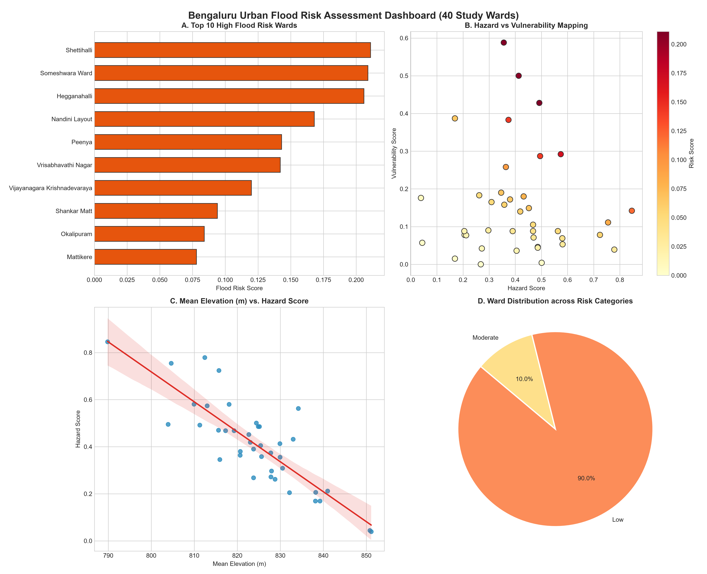
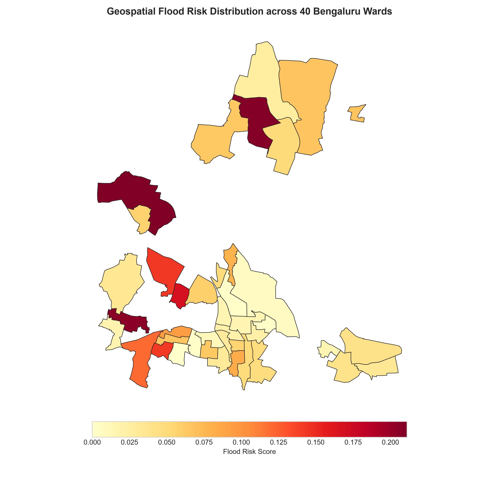
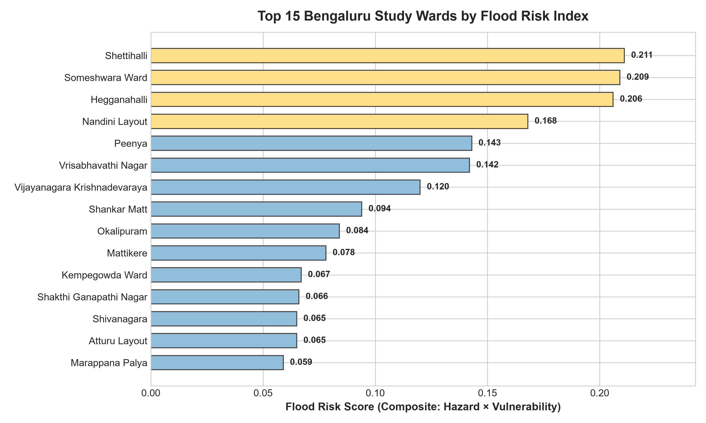
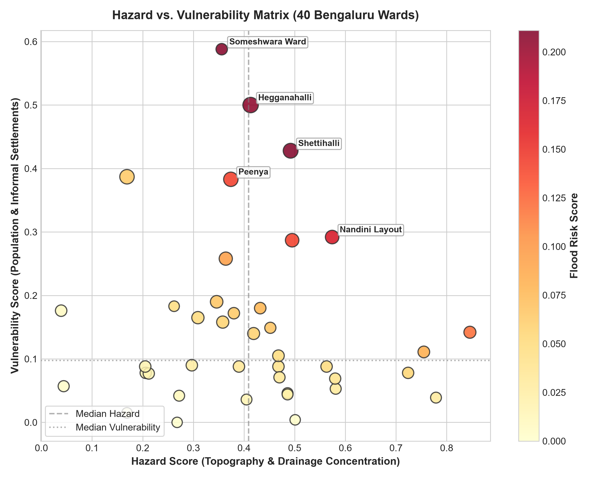
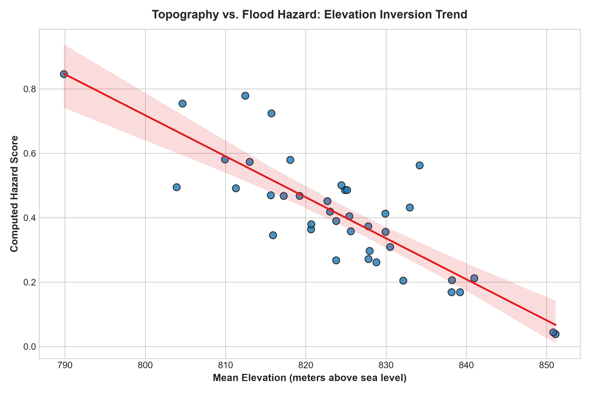
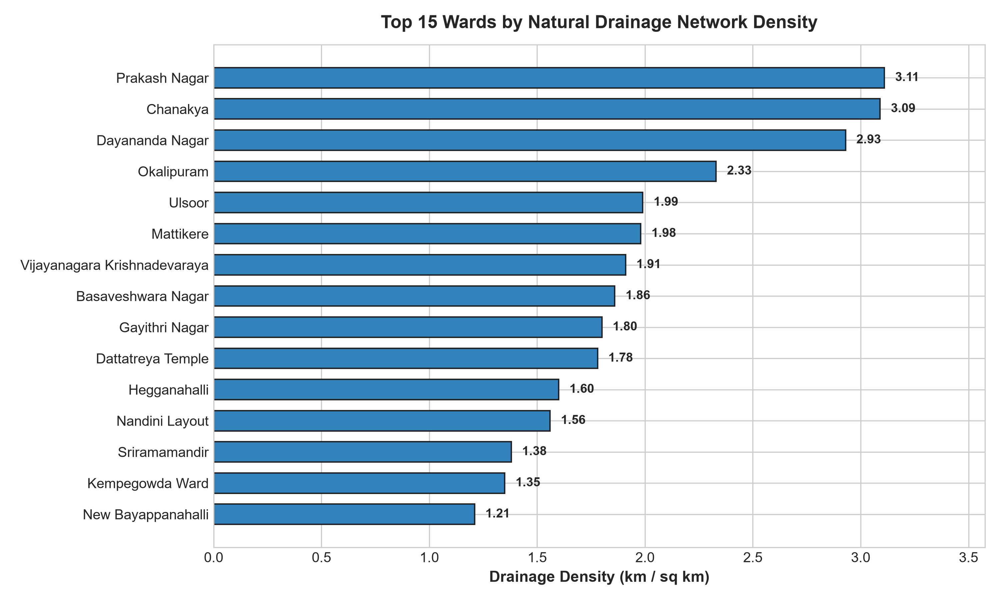

# Bengaluru Urban Flood Risk Assessment (40 Wards Prototype)

A spatial **Multi-Criteria Decision Analysis (MCDA)** pipeline designed to assess ward-level flood risk across 40 selected municipal wards in Bengaluru, Karnataka, India.

The project combines terrain characteristics, drainage infrastructure, and socioeconomic vulnerability indicators to develop a preliminary flood risk assessment.

---

## 📌 Executive Summary Dashboard


---

## 🗺️ Spatial Flood Risk Distribution


---

## 📊 Key Analysis & Figures

### 1. Top Flood Risk Wards
Identifies high-risk priority wards based on composite Hazard × Vulnerability modeling.


### 2. Hazard vs. Vulnerability Matrix
Maps topographic and drainage hazards against demographic and informal settlement vulnerability.


### 3. Topography vs. Hazard Score
Demonstrates the inverse relationship between mean elevation and flood hazard.


### 4. Drainage Network Density
Quantifies stream and stormwater drainage density (km / sq km) per ward.


---

## 1. Project Overview

Urban flooding is influenced by several factors, including low-lying terrain, drainage infrastructure, population density, and informal settlements.

This project aims to evaluate these factors at the ward level and generate a composite flood risk index for the 40 selected study wards in Bengaluru.

### Theoretical Framework

The assessment follows the conceptual relationship:

$$\text{Flood Risk} = \text{Hazard} \times \text{Vulnerability}$$

- **Hazard:** Represents physical susceptibility to flooding, using terrain elevation and drainage-related indicators.
- **Vulnerability:** Represents socioeconomic exposure, using population density and informal settlement counts.

The input indicators are normalized using Min-Max Scaling to a range of 0 to 1. Elevation is inversely normalized because lower-lying areas may be more susceptible to water accumulation.

The resulting hazard and vulnerability indicators are combined to derive composite flood risk scores and preliminary risk categories.

> [!NOTE]
> The risk index is a prototype analytical model. Its accuracy depends on data quality, indicator selection, weighting assumptions, and validation against observed flood events.

---

## 2. Project Architecture

The repository is organized into data directories, analysis reports, and modular Python scripts.

```text
bengaluru_flood_project/
│
├── data/
│   ├── raw/                           # Raw DEM, OSM waterways, Census and Slum datasets
│   └── processed/                     # Processed spatial layers and metrics
│       ├── final_flood_risk_40_wards.csv
│       ├── final_flood_risk_40_wards.geojson
│       ├── hazard_terrain_metrics.csv
│       ├── hazard_drainage_metrics.csv
│       └── vulnerability_metrics.csv
│
├── reports/
│   └── figures/                       # Generated publication-quality visualization figures
│
├── scripts/
│   ├── 01_inspect_wards.py
│   ├── 02_extract_40_wards.py
│   ├── 03_process_dem.py
│   ├── 04_process_drainage.py
│   ├── 05_process_vulnerability.py
│   ├── 06_compute_risk_index.py
│   └── 07_generate_visualizations.py
│
├── .gitignore
└── README.md
```

---

## 3. Data Processing Pipeline

The pipeline consists of modular stages executed sequentially.

| Stage | Script | Purpose |
|---|---|---|
| 1 | `01_inspect_wards.py` | Inspects the BBMP ward boundary KML file and identifies relevant attribute fields. |
| 2 | `02_extract_40_wards.py` | Selects the 40 study wards, standardizes coordinate references to EPSG:4326, and generates the study boundary GeoJSON. |
| 3 | `03_process_dem.py` | Processes ISRO Bhuvan CartoDEM elevation tiles and calculates zonal elevation statistics for each ward. |
| 4 | `04_process_drainage.py` | Processes OpenStreetMap waterways, calculates total drainage length, and derives drainage density for each ward. |
| 5 | `05_process_vulnerability.py` | Integrates 2011 Census demographic data and informal settlement counts to estimate socioeconomic vulnerability. |
| 6 | `06_compute_risk_index.py` | Normalizes indicators, computes composite risk scores, assigns risk categories, and generates consolidated outputs. |
| 7 | `07_generate_visualizations.py` | Generates high-resolution diagnostic charts, spatial risk choropleth maps, and the executive summary dashboard. |

### 3.1 Terrain Analysis
Elevation data from ISRO Bhuvan CartoDEM is used to derive terrain-related indicators:
- Mean elevation per ward
- Minimum elevation per ward
- Maximum elevation per ward

Lower elevations are treated as a potential indicator of greater flood susceptibility.

### 3.2 Drainage Analysis
OpenStreetMap waterway data is used to estimate drainage availability across the study wards:
- Total mapped drainage length in kilometres
- Drainage density in kilometres per square kilometre

Drainage density is used as a proxy indicator and does not, by itself, measure the actual capacity or condition of stormwater drains.

### 3.3 Vulnerability Analysis
Socioeconomic indicators are used to estimate the exposure of populations to potential flooding:
- Population from BBMP 2011 Census
- Informal settlement / slum counts

### 3.4 Composite Risk Assessment
The final stage applies Min-Max Scaling to the selected indicators and calculates composite hazard, vulnerability, and flood risk scores.

The resulting scores classify wards into preliminary categories:
- Low
- Moderate
- High
- Critical

---

## 4. Technology Stack

- **Programming Language:** Python 3.10+
- **Geospatial Processing:** GeoPandas, Fiona, Shapely
- **Raster Processing:** Rasterio, Rasterstats
- **Data Analysis & Visualization:** Pandas, NumPy, Matplotlib, Seaborn
- **Geospatial Data Sources:** ISRO Bhuvan CartoDEM, OpenStreetMap waterways, BBMP Census 2011

---

## 5. Setup and Installation

### Prerequisites
- Python 3.10 or later
- Git

### Step 1: Clone the Repository
```bash
git clone https://github.com/khushishetty05/bengaluru-flood-risk-model.git
cd bengaluru-flood-risk-model
```

### Step 2: Create a Virtual Environment
```bash
python -m venv .venv
```

**Windows PowerShell**
```powershell
.\.venv\Scripts\Activate.ps1
```

**Linux / macOS**
```bash
source .venv/bin/activate
```

### Step 3: Install Dependencies
```bash
python -m pip install --upgrade pip
pip install geopandas fiona shapely rasterio rasterstats pandas matplotlib seaborn
```

---

## 6. Running the Data Pipeline

Run the scripts in the following order from the project root directory:

```bash
python scripts/01_inspect_wards.py
python scripts/02_extract_40_wards.py
python scripts/03_process_dem.py
python scripts/04_process_drainage.py
python scripts/05_process_vulnerability.py
python scripts/06_compute_risk_index.py
python scripts/07_generate_visualizations.py
```

---

## 7. Expected Outputs

| Output File | Description |
|---|---|
| `data/processed/wards_40_clipped.geojson` | Standardized boundaries for the 40 selected study wards. |
| `data/processed/hazard_terrain_metrics.csv` | Mean, minimum, and maximum elevation metrics per ward. |
| `data/processed/hazard_drainage_metrics.csv` | Total mapped drainage length and drainage density per ward. |
| `data/processed/vulnerability_metrics.csv` | Population and informal settlement indicators per ward. |
| `data/processed/final_flood_risk_40_wards.csv` | Tabular dataset containing normalized indicators, composite scores, and risk categories. |
| `data/processed/final_flood_risk_40_wards.geojson` | Ward polygon dataset enriched with the final flood risk attributes. |
| `reports/figures/*.png` | 6 generated publication-quality figures and spatial choropleth maps. |

---

## 8. Limitations

- The assessment is a prototype and should not be treated as an official flood forecast or emergency warning system.
- Drainage density does not directly measure drainage capacity, blockages, or infrastructure condition.
- Population and informal settlement datasets may differ in reference year, coverage, and spatial accuracy.
- Composite risk scores depend on the indicators, normalization methods, weights, and classification thresholds selected.
- The model requires further validation against observed flood events before its results can support operational decisions.
